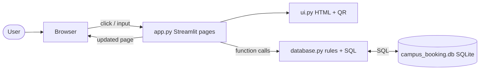

# EF101-P07 · Classroom / Laboratory Booking System

An information system that lets users **view, search and reserve classrooms and laboratories while preventing schedule conflicts**.
Built for **EF-101 Fall 2026 – System Understanding Projects** (submission: Monday, 9 November 2026).

**Stack:** Python · **Streamlit** (web front end, HTML views) · Python business-logic layer · **SQLite** SQL database.
No paid services and no API keys.

## ✨ Features

| Mandatory requirement | Where it is implemented |
|---|---|
| View room/lab list and details (≥ 10 rooms) | **Rooms & Labs** page · table `rooms` · demo data in `database.py` (`DEMO_ROOMS`) |
| Search/filter by capacity, type, equipment | `filter_rooms()` in `database.py`, widgets in `page_rooms()` |
| Select date, start time, end time | **Reserve Facility** page (`period_picker()`) |
| Display availability for the requested period | Live availability box on *Reserve Facility* + AVAILABLE/BUSY badges on *Rooms & Labs* (`find_conflicts()`, `busy_room_ids()`) |
| Create booking (requester, room, date/time, purpose) | `create_bookings()` → table `bookings` |
| Prevent double-booking / overlaps | Conflict query inside one SQL transaction **and** database trigger `trg_no_overlap` |
| Cancel a booking | **My Bookings** → *Cancel* (status becomes `Cancelled`, history is kept) |
| Daily and weekly schedule view | **Timetable View** (Daily = all rooms, Weekly = one room, 7 days) |
| Admin: add/edit rooms, inspect all bookings | **Admin Control** → *Bookings*, *Rooms* tabs |
| Persistent booking history | SQLite file `campus_booking.db` |
| Reject invalid time ranges | `validate_request()` + SQL `CHECK (end_time > start_time)` |

**Bonus features:** login with roles (student / admin, salted PBKDF2 password hashes) + student self-registration · approval workflow (Pending → Approved/Rejected) · simulated e-mail notifications (`email_log`) · recurring weekly bookings (all-or-nothing) · equipment selection per booking · **public live availability display** (`?room=CR-101`, `?board=1`) · **QR code per room** · CSV export · KPI dashboard · admin-editable rules (opening hours, max duration, time zone).

## 🚀 Run locally (for the instructor)

Requirements: **Python 3.9+** and Internet access once, for `pip install`.

```bash
git clone <this-repo-url>
cd campus-booking-system
python3 -m venv .venv && source .venv/bin/activate      # Windows: .venv\Scripts\activate
pip install -r requirements.txt
streamlit run app.py
```
Open **http://localhost:8501**. The database file `campus_booking.db` is created automatically on first start and filled with the demonstration data. Stop with `Ctrl+C`.

*GitHub Codespaces:* Code → Codespaces → Create. The dev container installs the requirements and starts the app on port 8501.

### Demo accounts
| Role | Username | Password |
|---|---|---|
| Student | `student` | `password123` |
| Administrator | `admin` | `admin123` |

Admin → **Settings & data → Reset demo data** restores the original rooms and bookings.

## ☁️ Deploy on Streamlit Community Cloud
1. Push this folder to a **public GitHub repository** (steps below).
2. Go to <https://share.streamlit.io> → sign in with GitHub → **Create app** → *Deploy a public app from GitHub*.
3. Repository: your repo · Branch: `main` · Main file path: **`app.py`** → **Deploy**.
4. Streamlit installs `requirements.txt` automatically. After the first start, open the app, log in as `admin` → **Settings & data** and set **Public URL** to your `https://<name>.streamlit.app` address so the QR codes point to the live site.

> **Important:** Streamlit Community Cloud has an *ephemeral* disk. The SQLite file is recreated with the demo data whenever the app is rebuilt or rebooted/idle-restarted, so bookings made on the cloud copy are **not guaranteed to survive a restart**. This is fine for a demonstration; see *Known limitations*.

### Push to GitHub
```bash
git init
git add .
git commit -m "EF101-P07 campus booking system"
git branch -M main
git remote add origin https://github.com/<your-user>/<your-repo>.git
git push -u origin main
```
(`.gitignore` already excludes the `.db` file and `__pycache__`.)

## 🧭 Suggested 2-minute demo (matches the project sheet)
1. Login as `student` → **Reserve Facility** → CR-102, tomorrow 10:00–11:00, purpose "Demo" → success (*Pending Approval*).
2. Reserve CR-102 tomorrow 10:30–11:30 → **conflict** (the page already shows red *Not available*; pressing Submit is also rejected).
3. **My Bookings** → cancel the first booking.
4. Reserve CR-201 at the same time → accepted (different room).
5. **Rooms & Labs** → Required equipment = *VR Headsets* → only LAB-102 and LAB-301.
6. Login as `admin` → **Admin Control → Bookings** → approve bookings → **Timetable View → Weekly**.
7. Terminal: show the same rows with
   `sqlite3 campus_booking.db "SELECT booking_id, room_id, book_date, start_time, end_time, status FROM bookings;"`

## 🏗️ Architecture




More detail (sequence diagram, ER diagram, viva Q&A): [`docs/ARCHITECTURE.md`](docs/ARCHITECTURE.md), [`docs/VIVA_PREP.md`](docs/VIVA_PREP.md).

## 💾 Data & storage
Five SQL tables – `users`, `rooms`, `bookings`, `email_log`, `settings` – defined in [`db/schema.sql`](db/schema.sql). `room_id`, `user_id`, `booking_id` are primary keys; `bookings.room_id` and `bookings.user_id` are foreign keys; CHECK constraints and a trigger stop invalid or overlapping bookings even if application code had a bug. SQLite was chosen because it is a genuine SQL database that ships with Python and needs no server installation or paid hosting.

## 🗂️ Repository structure
```
campus-booking-system/
├── app.py                    Streamlit front end: pages, widgets, login state
├── database.py               business rules + all SQL (validation, conflicts, transactions)
├── ui.py                     HTML builders (cards, timetable, public display) + QR code
├── db/schema.sql             tables, keys, constraints, no-overlap trigger
├── requirements.txt          streamlit, segno, tzdata
├── .streamlit/config.toml    theme / server settings
├── .devcontainer/            GitHub Codespaces setup
├── tests/                    unit tests (data layer, HTML helpers, Streamlit AppTest)
├── docs/
│   ├── ARCHITECTURE.md · architecture.svg/png   diagrams, data flow
│   ├── TESTING.md · test_results.txt            test cases and evidence
│   ├── REPORT.md (+ REPORT.docx)                project report
│   ├── VIVA_PREP.md                             viva questions + live-modification guide
│   └── screenshots/                             add your screenshots here
├── metadata.json · .gitignore · README.md
```

## ✅ Testing
```bash
python3 -m unittest discover -s tests -v
```
61 automated tests pass on the data layer and HTML helpers (`docs/test_results.txt`); 3 more tests render every page with Streamlit's `AppTest` and run only where Streamlit is installed. Manual browser scenarios are in `docs/TESTING.md`.

## ⚠️ Known limitations
* SQLite suits one small server; a large deployment would use PostgreSQL/MySQL.
* On Streamlit Community Cloud the disk is ephemeral – data is reset on restart (use an external database for real persistence).
* Login state lives in the browser session: refreshing the page signs you out. There is no HTTPS handling, password reset or session timeout beyond what the host provides.
* E-mail notification is simulated (rows in `email_log`; nothing is sent).
* Deleting `campus_booking.db` deletes real bookings (demo data is recreated automatically).

## 🧰 Tool and AI disclosure
| Item | Use |
|---|---|
| Python 3 standard library (`sqlite3`, `hashlib`, `csv`, `zoneinfo`, `unittest`) | Database layer, rules, tests |
| Streamlit | Web front end and hosting platform |
| segno | QR-code generation |
| pandas (installed with Streamlit) | Tables and chart |
| Claude (Anthropic) | Reviewed the earlier JavaScript/Python version supplied by the group and re-implemented it as a Streamlit + SQLite application; wrote the tests and documentation drafts |
| FILL IN: any AI tool / template used to write the original `index.html` | |

All members must read and understand the code (see `docs/VIVA_PREP.md`).

## 👥 Contribution statement
| Member | Student ID | Meaningful contribution |
|---|---|---|
| FILL IN | FILL IN | FILL IN |
| FILL IN | FILL IN | FILL IN |
| FILL IN | FILL IN | FILL IN |

## 📄 Licence
Academic project – MIT licence for the code. Libraries belong to their respective authors.
